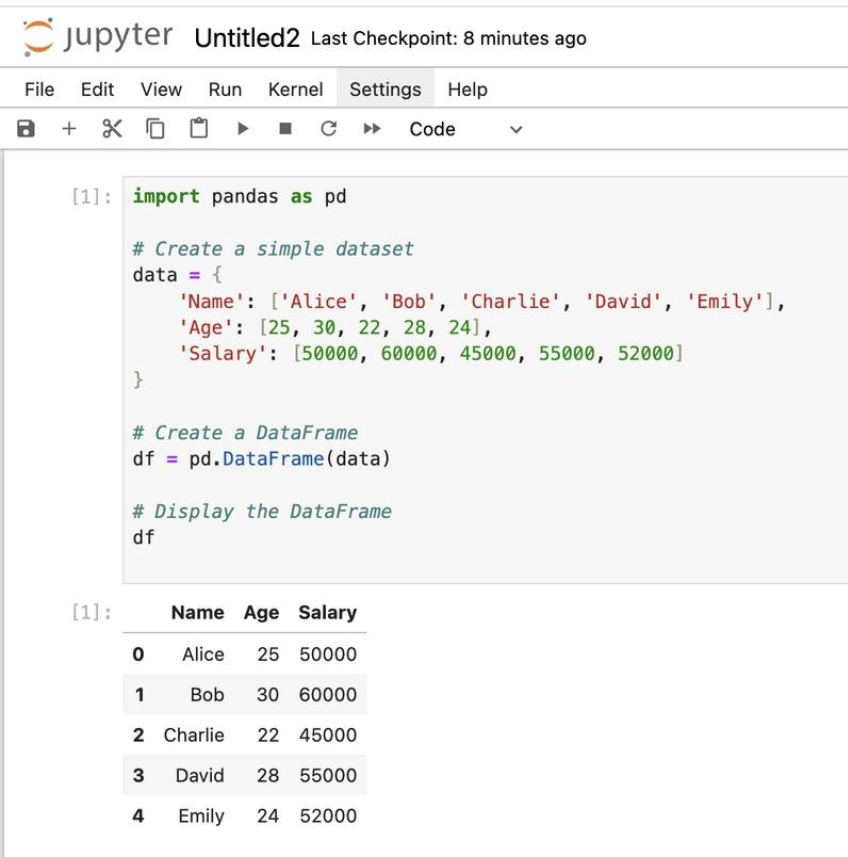
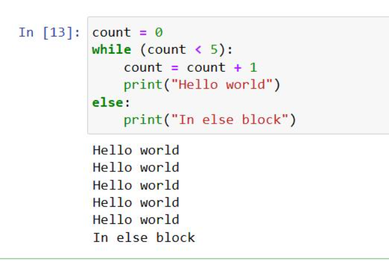
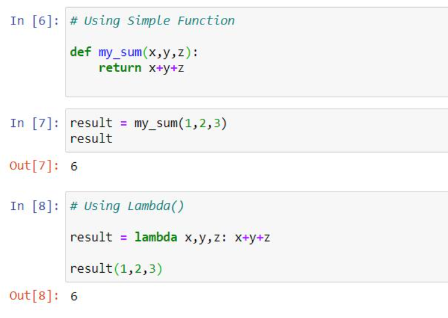
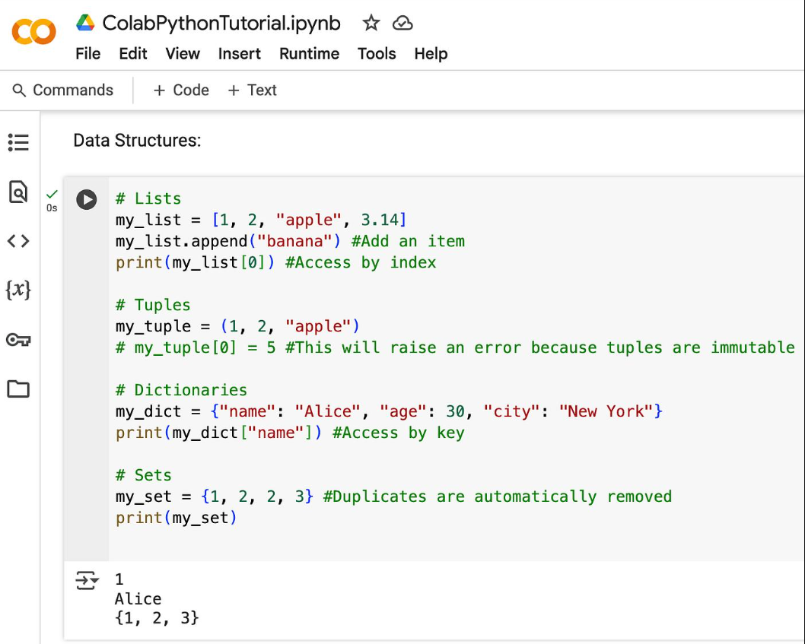
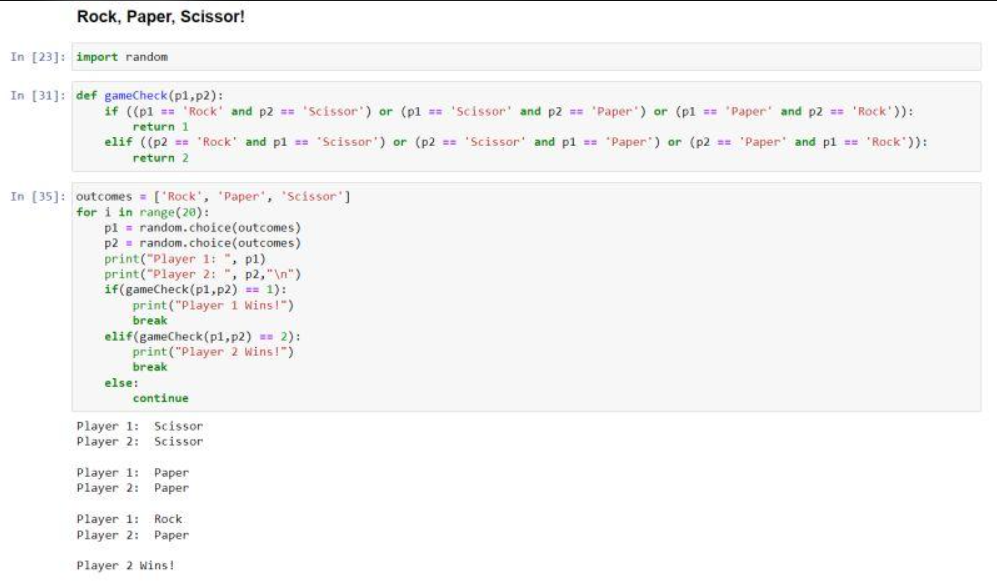

# Maji Ndogo: Agricultural Data Analysis Using Python

## 1. The Business Problem

The Maji Ndogo project focused on agricultural challenges that required a data-driven approach to decision-making. Working within agricultural scenarios, the project applied Python programming to investigate problems, structure information, and develop solutions using logical and analytical techniques.

The objective was to use programming to transform problem requirements into structured solutions, making information easier to work with and helping demonstrate how analytical thinking can be applied to real-world challenges.

## 2. The Tech Stack

- **Programming language:** Python
- **Environment:** Jupyter Notebook / Python
- **Core concepts:** Variables, data structures, conditional statements, loops, functions, list comprehensions, dictionary comprehensions, sets, sorting, and nested dictionaries.

## 3. The Deliverable

This project demonstrates the application of Python foundations through practical problem-solving exercises based on agricultural scenarios.

The work includes implementing functions, processing structured information, applying conditional logic, using loops, creating comprehensions, working with sets, and managing nested dictionaries.

### Project Evidence

#### Data Exploration and Structure

#### Logical Decisions

#### Functions and Reusable Logic

#### Data Structures

#### Final Solution

## 4. The So What?

This project strengthened my ability to break down problems into smaller components and translate requirements into Python code. It helped develop my understanding of programming logic, reusable functions, data structures, and structured problem-solving.

These foundations are important for progressing into more advanced data analysis and data science projects, where the ability to manipulate information, apply logic, and build reliable solutions is essential.
